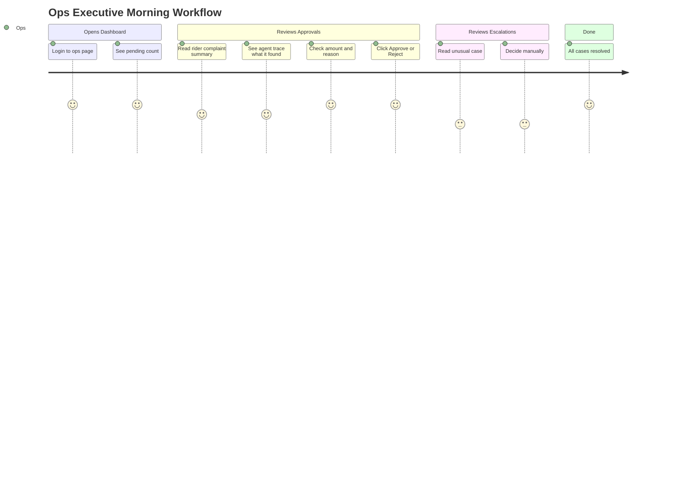
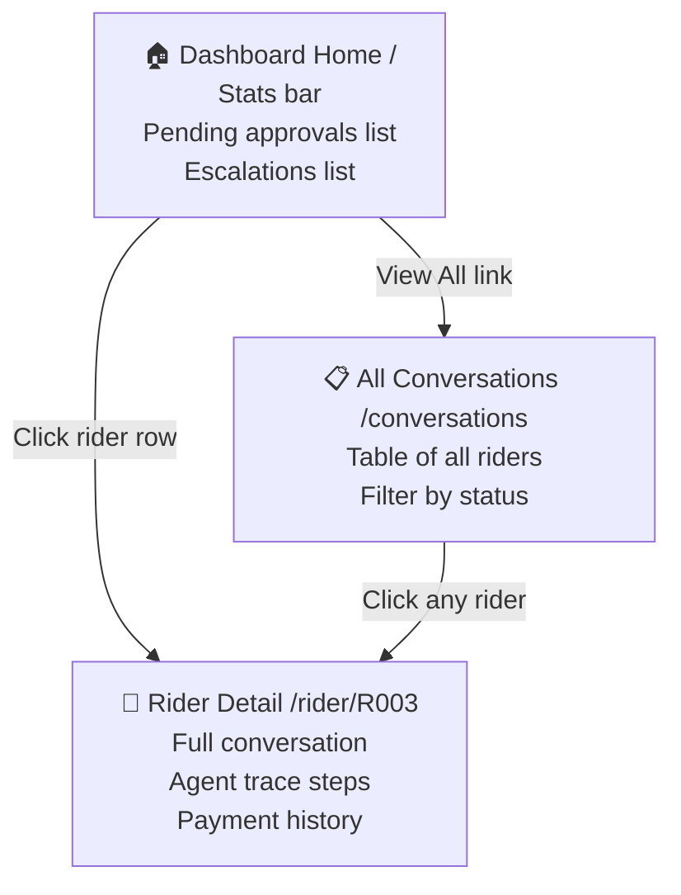
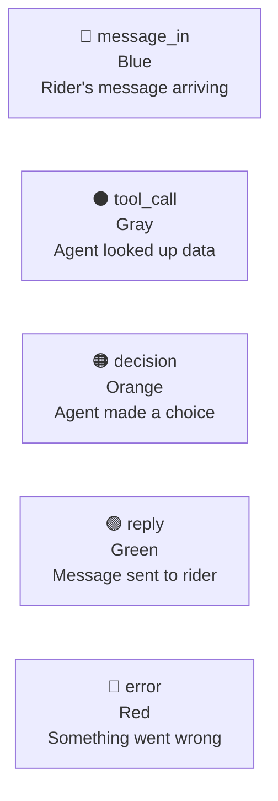
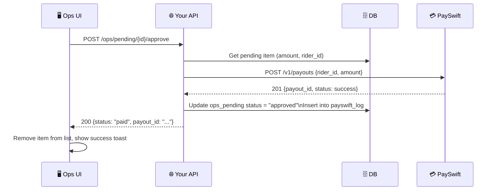
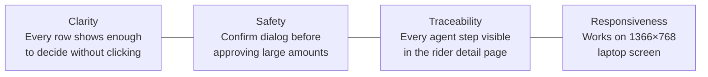

# Design — UI/UX Direction
## QuickDrop — Ops Dashboard

> **Who uses this?** Ops executives (Meera's team), not riders.
> **Goal?** Let them see what's pending, understand why, and approve/reject confidently.
> **When?** They open this every morning to review overnight disputes.

---

## 1. WHY a Dashboard at All?

Meera said: *"my team needs to see what happened and why"* and *"I need to trust it before it moves money."*

The dashboard exists to:
1. Build **trust** — show ops exactly what the AI decided and why
2. Enable **approval** — for disputes > ₹200 that need a human
3. Show **escalations** — unusual cases (accident claim, distance dispute)



---

## 2. Pages & Navigation



### Page 1: Dashboard Home

```
┌────────────────────────────────────────────────────────────────┐
│  QuickDrop Ops Dashboard              Last updated: 09:05 IST  │
│  ──────────────────────────────────────────────────────────────│
│  [ 3 Pending Approvals ]   [ 2 Escalations ]   [ 18 Resolved ]│
│                                                                │
│  ━━━━━━━━━━━━━━━━━━━━━━━━━━━━━━━━━━━━━━━━━━━━━━━━━━━━━━━━━━━ │
│  PENDING APPROVALS                                             │
│  ┌────────────┬────────────┬──────┬──────────────────┬───────┐│
│  │ Rider      │ Created    │ ₹    │ Reason           │       ││
│  ├────────────┼────────────┼──────┼──────────────────┼───────┤│
│  │ R016 Anil  │ 11:30 AM   │ 425  │ 5 trips missing  │✓ ✗   ││
│  │ R034 Pradeep│ 11:30 AM  │ 249  │ 3 trips missing  │✓ ✗   ││
│  │ R027 Nitin │ 10:31 AM   │  10  │ Repeat same day  │✓ ✗   ││
│  └────────────┴────────────┴──────┴──────────────────┴───────┘│
│                                                                │
│  ━━━━━━━━━━━━━━━━━━━━━━━━━━━━━━━━━━━━━━━━━━━━━━━━━━━━━━━━━━━ │
│  ESCALATIONS                                                   │
│  ┌────────────┬──────────────────────────────────────────────┐│
│  │ Rider      │ Reason                               │ View  ││
│  ├────────────┼──────────────────────────────────────────────┤│
│  │ R036 Vinod │ Disputes distance record T990831             ││
│  │ R028 Sameer│ Cancel penalty — accident claim              ││
│  └────────────┴──────────────────────────────────────────────┘│
└────────────────────────────────────────────────────────────────┘
```

### Page 2: Rider Detail View

```
┌────────────────────────────────────────────────────────────────┐
│  ← Back   R016 — Anil Chauhan   Hyderabad   Joined: Apr 2025  │
│  ──────────────────────────────────────────────────────────────│
│  ┌──────────────────────────┐ ┌────────────────────────────┐  │
│  │ CONVERSATION             │ │ AGENT TRACE                │  │
│  │                          │ │                            │  │
│  │ 11:30 AM RIDER:          │ │ 11:30:00 message_in        │  │
│  │ "19 sept ke 5 orders ka  │ │   text: "19 sept ke 5..."  │  │
│  │  paisa hi nahi aaya"     │ │                            │  │
│  │                          │ │ 11:30:01 tool_call         │  │
│  │ 11:30:05 AGENT:          │ │   get_trips(R016, Sep 19)  │  │
│  │ "19 Sep ko 5 trips milte │ │   → [T1,T2,T3,T4,T5]      │  │
│  │  hain. Expected ₹425 but │ │                            │  │
│  │  ₹0 paid. Amount > ₹200, │ │ 11:30:02 tool_call         │  │
│  │  ops approval needed."   │ │   get_payout_lines(R016)   │  │
│  │                          │ │   → [] (nothing paid!)     │  │
│  │                          │ │                            │  │
│  │                          │ │ 11:30:02 decision          │  │
│  │                          │ │   expected: ₹425, paid: ₹0 │  │
│  │                          │ │   action: queue_approval   │  │
│  └──────────────────────────┘ └────────────────────────────┘  │
│                                                                │
│  PENDING ACTION: ₹425 approval                                 │
│  ┌──────────────────┐  ┌──────────────────────────────────┐   │
│  │  ✓ APPROVE ₹425  │  │  ✗ Reject (optional note)       │   │
│  └──────────────────┘  └──────────────────────────────────┘   │
└────────────────────────────────────────────────────────────────┘
```

---

## 3. Color Coding for Trace Steps

**WHY color coding?** Ops executives need to quickly scan what happened. Color lets them spot errors or decisions at a glance.



| Step type | Color | What it means |
|---|---|---|
| `message_in` | 🔵 Blue | A rider message arrived |
| `tool_call` | ⚫ Gray | Agent called a DB function |
| `decision` | 🟠 Orange | Agent decided something (pay/escalate/explain) |
| `reply` | 🟢 Green | Agent sent a reply to the rider |
| `error` | 🔴 Red | Something failed — needs attention |

---

## 4. UI Implementation

**Tech stack**: Plain HTML + CSS + Vanilla JS (or React if preferred).

**WHY not React?** This is a simple CRUD dashboard. React adds build complexity for marginal benefit. Plain HTML is faster to build and deploy.

### API Calls the UI Makes

```javascript
// Load pending items
const pending = await fetch('/ops/pending').then(r => r.json());

// Load rider trace
const trace = await fetch(`/trace/${riderId}`).then(r => r.json());

// Approve a pending item (you design this endpoint)
await fetch(`/ops/pending/${itemId}/approve`, { method: 'POST' });

// Reject a pending item
await fetch(`/ops/pending/${itemId}/reject`, {
  method: 'POST',
  body: JSON.stringify({ note: "Reason for rejection" })
});
```

### Minimal HTML Structure

```html
<!DOCTYPE html>
<html lang="en">
<head>
  <title>QuickDrop Ops Dashboard</title>
  <style>
    /* Color tokens */
    :root {
      --color-approve: #4CAF50;
      --color-reject: #f44336;
      --color-pending: #FF9800;
      --color-trace-message: #2196F3;
      --color-trace-tool: #9E9E9E;
      --color-trace-decision: #FF9800;
      --color-trace-reply: #4CAF50;
      --color-trace-error: #f44336;
    }
  </style>
</head>
<body>
  <header>
    <h1>QuickDrop Ops Dashboard</h1>
    <div class="stats">
      <span id="pending-count">— Pending</span>
      <span id="escalation-count">— Escalations</span>
    </div>
  </header>

  <section id="approvals">
    <h2>Pending Approvals</h2>
    <table id="approvals-table">
      <thead><tr><th>Rider</th><th>Amount</th><th>Reason</th><th>Actions</th></tr></thead>
      <tbody><!-- filled by JS --></tbody>
    </table>
  </section>

  <section id="escalations">
    <h2>Escalations</h2>
    <!-- filled by JS -->
  </section>

  <script src="app.js"></script>
</body>
</html>
```

### app.js (Minimal Working Version)

```javascript
async function loadDashboard() {
  const items = await fetch('/ops/pending').then(r => r.json());

  const approvals = items.filter(i => i.type === 'approval');
  const escalations = items.filter(i => i.type === 'escalation');

  document.getElementById('pending-count').textContent = `${approvals.length} Pending`;
  document.getElementById('escalation-count').textContent = `${escalations.length} Escalations`;

  const tbody = document.querySelector('#approvals-table tbody');
  tbody.innerHTML = approvals.map(item => `
    <tr>
      <td>${item.rider_id}</td>
      <td>₹${item.amount}</td>
      <td>${item.reason}</td>
      <td>
        <button onclick="approve('${item.id}')" style="background:var(--color-approve);color:#fff">
          ✓ Approve
        </button>
        <button onclick="reject('${item.id}')" style="background:var(--color-reject);color:#fff">
          ✗ Reject
        </button>
      </td>
    </tr>
  `).join('');
}

async function approve(id) {
  if (!confirm('Approve this payment?')) return;
  await fetch(`/ops/pending/${id}/approve`, { method: 'POST' });
  loadDashboard(); // refresh
}

async function reject(id) {
  const note = prompt('Reason for rejection (optional):');
  await fetch(`/ops/pending/${id}/reject`, {
    method: 'POST',
    headers: { 'Content-Type': 'application/json' },
    body: JSON.stringify({ note })
  });
  loadDashboard();
}

loadDashboard();
setInterval(loadDashboard, 30000); // auto-refresh every 30s
```

---

## 5. Ops Approval Flow — Backend

When ops clicks **Approve**, your backend needs to:



```python
@app.post("/ops/pending/{item_id}/approve")
async def approve_pending(item_id: str, db: Session = Depends(get_db)):
    item = db.query(OpsPending).filter_by(id=item_id, status="pending").first()
    if not item:
        raise HTTPException(404, "Item not found or already resolved")

    # Pay via PaySwift
    result = payswift_client.post_payout(
        rider_id=item.rider_id,
        amount=item.amount,
        reference=f"ops-approved-{item_id}"
    )

    # Update DB
    item.status = "approved"
    item.resolved_at = datetime.utcnow()
    db.add(PayswiftLog(rider_id=item.rider_id, amount=item.amount,
                       payswift_payout_id=result["payout_id"]))
    db.commit()
    return {"status": "paid", "payout_id": result["payout_id"]}
```

---

## 6. Design Principles Summary


