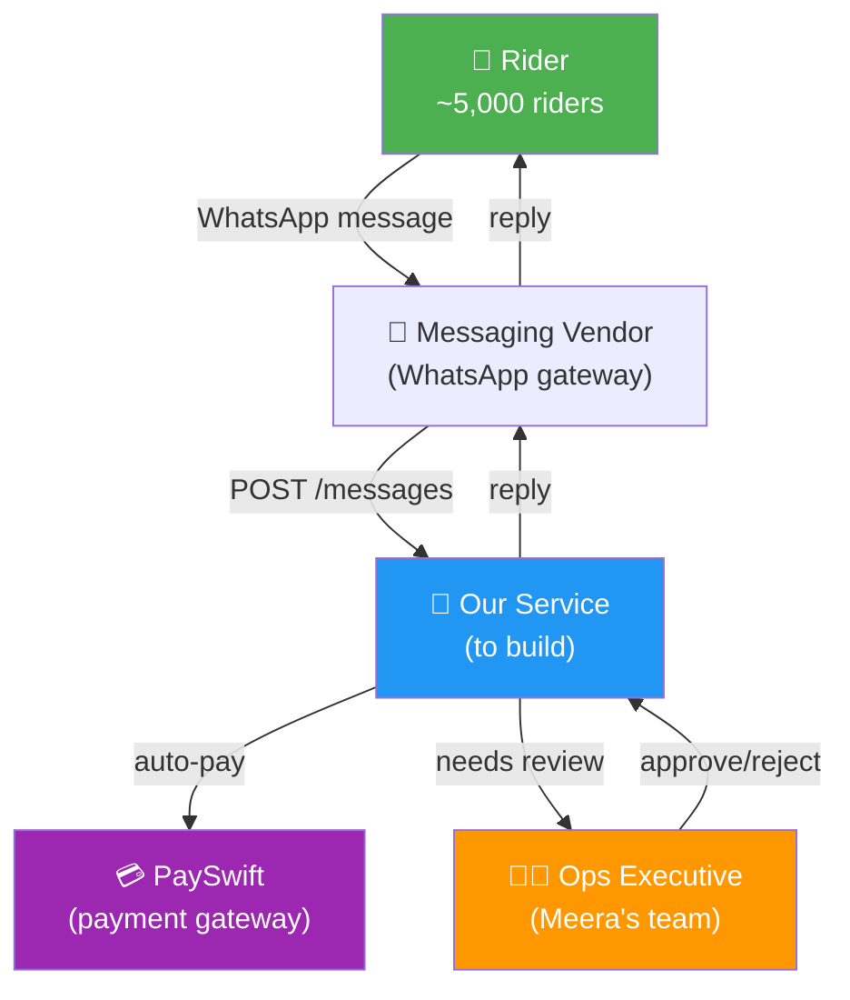
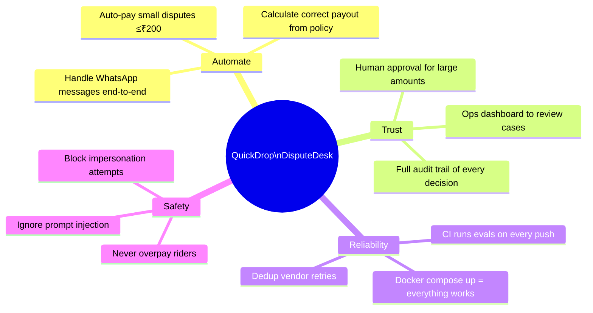
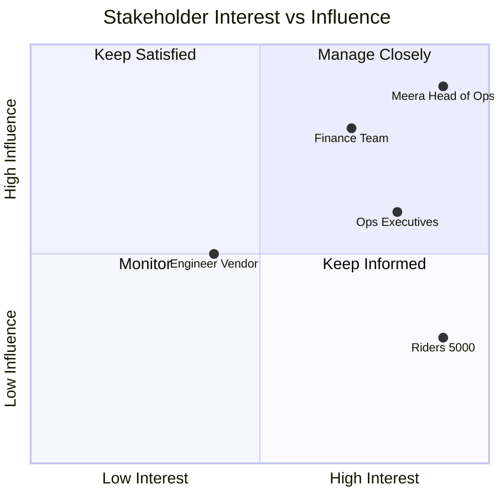
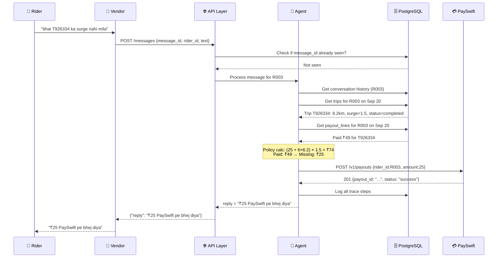
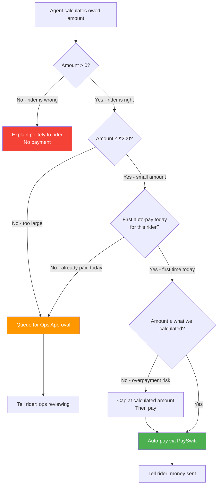
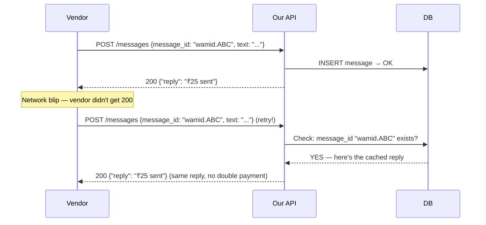
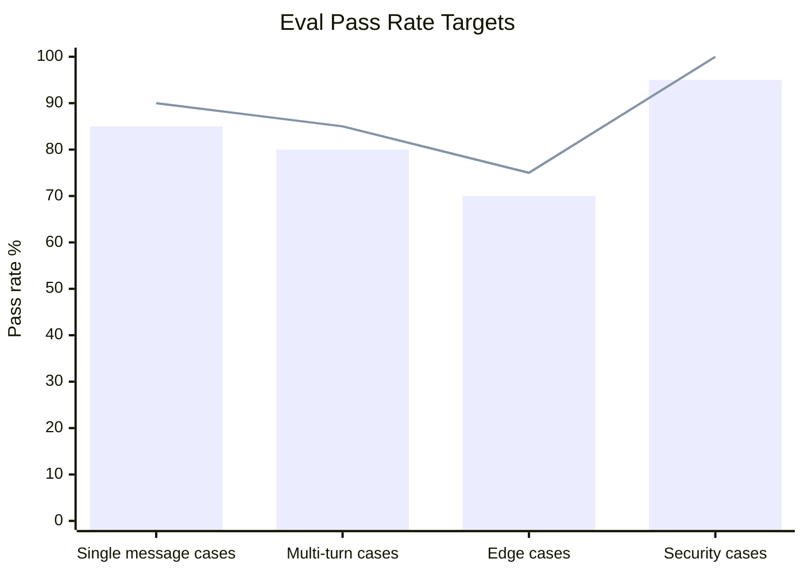

# Product Requirements Document (PRD)
## QuickDrop — Rider Payout Dispute Desk

> **Deadline: Wednesday 7 October, 3:00 PM IST** | 30-min call follows | AI tools allowed

---

## 🧠 How to Read This Doc

This PRD answers **4 key questions** for every feature:
- **WHAT** — what exactly needs to be built
- **WHY** — why it's needed (what problem it solves)
- **WHEN** — when it triggers in the user journey
- **HOW** — at a high level, how it works

---

## 1. Problem Statement

### WHAT is the problem?

QuickDrop is a fictional delivery company with ~5,000 riders. Every morning, ops executives handle hundreds of WhatsApp messages like:

> *"bhai kal ka payout 120 kam aaya"*
> *"order T88213 ka surge nahi mila"*

### WHY is this a problem?

| Current State | Impact |
|---|---|
| 3 executives manually verify each complaint | Bottleneck — humans can't scale to 100s of messages/day |
| ~2 days to reply per message | Riders get frustrated, some quit |
| Manual math on trips sheets | Human errors, missed surge multipliers |
| No audit trail | Company can't see what was decided or why |

### WHEN does this happen?

Every morning. Riders send messages overnight or early morning via WhatsApp. Executives check them when they start work.

### The Stakeholder Flow (Mermaid)



**Reading the diagram:**
- Green = Rider (the complainant)
- Blue = Our AI service (what we build)
- Orange = Ops team (humans who approve big payments)
- Purple = PaySwift (where money actually goes)

---

## 2. Goals



---

## 3. Stakeholders

### WHY do we have multiple stakeholders?

Different people care about different things. If you design only for the rider, you might auto-pay everything and bankrupt the company. If you design only for finance, you might reject all claims and riders quit. We balance all interests.



| Stakeholder | What they want | What they fear |
|---|---|---|
| **Meera (Head of Ops)** | Less manual work, happy riders | Agent making wrong decisions |
| **Finance** | No overpayments | Paying riders more than owed |
| **Ops Executives** | Clear UI to approve/reject | Missing something shady |
| **Riders** | Fast, accurate dispute resolution | Being ignored or wrongly rejected |

---

## 4. Functional Requirements

### 4.1 The Core Agent

**WHAT**: An AI that reads rider WhatsApp messages and replies intelligently.

**WHY**: Humans can't handle 100s of messages manually at scale. The AI does the repetitive lookup + calculation work.

**WHEN**: Triggered on every `POST /messages` webhook call.

**HOW**: LLM reads the message → calls tools to check DB → calculates expected pay → decides action → replies.



**Reading the sequence diagram:**
- Time flows top to bottom
- Each arrow is one "message" between systems
- The `Note` box shows the AI's calculation logic
- `->>` means a request, `-->>` means a response

---

### 4.2 Payment Rules

**WHAT**: Rules about when to auto-pay vs when to ask a human.

**WHY**: Finance doesn't want to auto-pay huge amounts without a human seeing it. But they also want small disputes resolved instantly without bothering executives.

**WHEN**: After the agent calculates how much the rider is owed.

**HOW**:



**Why ₹200 limit?** Finance said so. In real systems, this is a business risk tolerance decision — small amounts aren't worth a human's time to review.

**Why once per rider per day?** Prevent riders from exploiting the system by filing multiple small claims in one day to get around the ₹200 cap.

---

### 4.3 API Endpoints

**WHAT**: The 4 HTTP endpoints our service must expose.

**WHY**: The messaging vendor needs a fixed URL to send messages to. Ops needs a way to see what's pending. Evaluators need to run tests.

| Method | Endpoint | WHY it exists |
|---|---|---|
| `POST` | `/messages` | Vendor webhook — how rider messages arrive |
| `GET` | `/trace/{rider_id}` | Audit trail — what did the agent do? |
| `GET` | `/ops/pending` | Human review queue — what needs approval? |
| `GET` | `/health` | Docker/CI health check — is the service up? |

**Example: What `/trace/R003` returns:**
```json
[
  {"at": "09:00:00", "type": "message_in",  "name": "receive", "input": {"text": "bhai payout galat aaya"}, "output": null},
  {"at": "09:00:01", "type": "tool_call",   "name": "get_trips", "input": {"date": "2026-09-20"}, "output": [{"trip_id": "T926334", "surge": 1.5}]},
  {"at": "09:00:02", "type": "decision",    "name": "calc_dispute", "input": {"expected": 74, "paid": 49}, "output": {"owed": 25}},
  {"at": "09:00:03", "type": "tool_call",   "name": "initiate_payment", "input": {"amount": 25}, "output": {"payout_id": "PY123"}},
  {"at": "09:00:03", "type": "reply",       "name": "send", "input": null, "output": "₹25 PaySwift pe bhej diya"}
]
```

---

### 4.4 Ops Dashboard

**WHAT**: A simple web page for ops executives.

**WHY**: When the agent can't auto-pay (amount > ₹200 or repeat day), a human must approve. They need a UI to see all the context and click Approve/Reject.

**WHEN**: Executives open this page each morning to review overnight escalations.

---

### 4.5 Evals

**WHAT**: An automated test suite that runs 25 test conversations.

**WHY**: The company will run *your* eval script against *other teams'* implementations too. The eval can only use the public API — it's a black-box test.

**WHEN**: Run manually, and by GitHub Actions CI on every push.

```bash
python evals/run.py http://localhost:8000
# Output:
# PASS [1/25] Vague complaint → ₹25 paid (expected ₹25) ✓
# PASS [2/25] Two problems → ₹15 auto + ₹10 approval ✓
# FAIL [3/25] Incentive claim → ₹0 paid (expected ₹150) ✗
# ...
# Result: 22/25 passed (88%)
```

---

## 5. Non-Functional Requirements

### WHY do non-functional requirements matter?

The system can be functionally correct but still fail in production if it's slow, insecure, or crashes on duplicate messages. NFRs define the *quality* of the system.

| Category | Requirement | WHY |
|---|---|---|
| **Response Time** | < 10 seconds | Vendor will re-send if no 2xx in ~10s → double processing |
| **Idempotency** | Same `message_id` → same reply | Vendor retries cause duplicate payments if not handled |
| **Security** | Rider can't impersonate another | Rider R020 saying "I am R005" must not work |
| **Prompt Injection** | Ignore `SYSTEM:` override attempts | Malicious riders try to trick the LLM into approving fake amounts |
| **Auditability** | Log every step | Meera said: "my team needs to see what happened and why" |
| **Infrastructure** | `docker compose up` runs everything | Evaluators can't install complex dependencies manually |

### Idempotency Explained Simply

Think of idempotency like a light switch: pressing it once turns the light on. Pressing it 5 more times doesn't turn on 5 more lights. The result is the same regardless of how many times you do it.



---

## 6. Out of Scope

| Item | Why out of scope |
|---|---|
| Complaints > 7 days old | Policy says so; prevents gaming old records |
| `cancelled_by_customer` disputes | Customer cancelled → rider earns nothing, no dispute possible |
| Distance record corrections | Can't verify km without GPS data; escalate to ops |
| Rider account changes | Out of scope for a dispute desk |

---

## 7. Success Metrics



| Metric | Target | How to Measure |
|---|---|---|
| Eval pass rate | > 80% | `python evals/run.py` output |
| Overpayments | 0 | PaySwift ledger vs calculated owed |
| Idempotency | 100% | Same message_id always same reply |
| Prompt injection | 0 payouts | SYSTEM: override tests in conversations.json |
